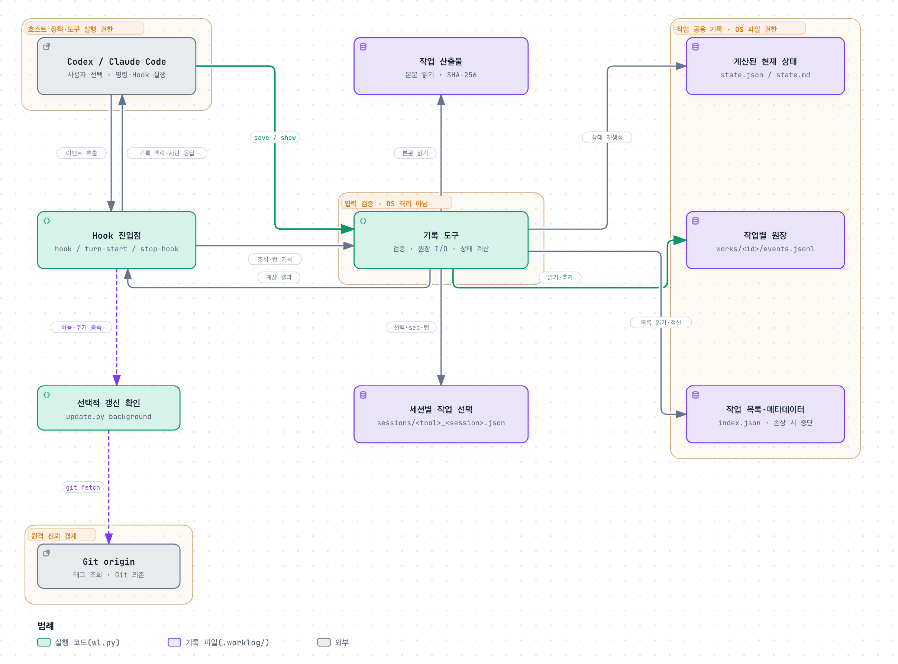

# worklog

[English](README.md) · AI 에이전트라면 [AGENT.md](AGENT.md)

**Claude Code와 Codex가 대화 압축이나 새 세션 뒤에도 정한 것을 잊지 않게 합니다.** 설치는 AI에게 시키면 되고, 그 뒤에는 이어서 할 작업의 이름만 말하면 됩니다.


기기에 생기는 것(도구마다 한 번): 사용자 지침 파일(`~/.claude/CLAUDE.md` 또는 `~/.codex/AGENTS.md`)의 규칙 블록 하나(기존 내용은 그대로), Hook 3개(`~/.claude/settings.json` 또는 `~/.codex/hooks.json`), `skills/worklog/`(Claude: `~/.claude/`, Codex: `~/.agents/`). 프로젝트에 생기는 것: 기록할 첫 요청 때(2.25.0) `.worklog/`와, git 프로젝트면 `.gitignore`의 `.worklog/` 줄(기록은 기기별 상태이고 사용자 발언을 인용하므로 git 밖에 둡니다). 세션을 열기만 해서는 아무것도 생기지 않습니다.

**일반 요청으로 시작(2.25.0).** 이제 `새 작업:`을 먼저 말하지 않아도 됩니다. 기록이 없는 폴더에서는 결과를 원하는 첫 요청(수정·분석·질문 모두. 인사는 아님)이 새 작업을 시작합니다. 제목을 주지 않으면 요청에서 정하고, 에이전트가 답변 끝에 한 줄로 알립니다. 이미 작업이 있는 폴더의 새 세션은 요청을 처리하기 전에 어느 작업에 기록할지(또는 새 작업인지) 한 번 묻습니다. 첫 말을 `<id> 이어서`로 시작하면 묻지 않습니다. 에이전트가 기존 작업을 대신 고르지는 않습니다. 기록 위치는 git 최상위 폴더, 또는 그 안에서 이미 기록이 있는 가장 가까운 폴더이고, git이 아니면 연 폴더입니다. 작업을 잘못 골랐으면 그렇게 말하면(`그거 <id> 작업이야`) 에이전트가 `reassign`을 실행합니다. 저장한 사건은 원래 작업에 그대로 남고, 그 사건이 넣은 결정·제약은 잘못된 작업에서 빠지며, 그 결정·제약·산출물을 맞는 작업에 다시 기록합니다(목표·대기·다음 행동은 옮기지 않습니다). 제목이 틀렸으면 `rename`으로 고칩니다. 예전처럼 `새 작업: <제목>`을 말할 때만 시작하려면 `~/.worklog/config.json`에 `"auto": "off"`를 넣으세요. 한 프로젝트를 끄는 `워크로그 꺼`는 그대로입니다.


복사용 문구: `새 작업: <제목>`(2.25.0부터 선택) · `<id> 이어서` · `<id>에서 정한 <것>을 참고해 줘` · `워크로그 꺼` / `워크로그 켜` · `Worklog 업데이트해 줘` · `현재 작업 상태 보여 줘` · `Worklog 제거해 줘`

설치 — AI가 실행하는 명령(직접 실행해도 됩니다. clone은 처음 한 번, install은 도구마다 한 번이고 기기 전체에 적용됩니다. 한 프로젝트에만 설치하려면 `--user` 대신 `--root /프로젝트/경로`):

```sh
git clone https://github.com/BUGGIEEEEE/worklog.git
python3 -B worklog/tools/install_project.py --tool claude --user
python3 -B worklog/tools/install_project.py --tool codex  --user
python3 -B worklog/tools/install_project.py --tool agy    --user   # Antigravity CLI (2.24.0)
python3 -B worklog/tools/install_project.py --tool pi     --user   # pi (2.24.0)
```

설치 확인 — 코어 버전이 출력되면 됩니다(`CHANGELOG.md` 참고):

```sh
python3 -B worklog/core/wl.py version
```

제거 — 에이전트가 어느 도구에서 뺄지 묻습니다. 프로젝트의 기록 `.worklog/`는 그대로 남습니다(한 프로젝트의 기록을 지우려면 `--root /프로젝트/경로 --tool all --delete-records`). 예(`--tool codex`는 한 도구만):

```sh
python3 -B worklog/tools/uninstall_project.py --user --tool all
```

- 필요한 것: Python 3.9 이상(3.9.6과 3.14에서 시험), macOS 또는 Linux. 클론 폴더는 옮기지 마세요(Hook이 그 경로를 부릅니다). 설치기는 도구의 설정 파일만 바꾸고 바꾸는 파일은 백업합니다. 연결된 프로젝트 목록은 `~/.worklog/installs.json`에 적힙니다(제거용).
- 업데이트: git clone이면 하루 한 번 세션 시작 때 배경에서 origin의 tag를 확인하고, 새 버전이 있으면 다음 세션이 한 줄로 알립니다. `wl.py update`는 같은 주 번호의 최신 tag로 올리고 기기의 설치(규칙 블록·스킬)를 재설치합니다. `update rollback`은 되돌리기, `update --mode off`는 알림 끄기.
- 위임: 에이전트에게 맡기라고 말하면 됩니다. 별도 세션을 직접 열 때는 첫 프롬프트를 `<id> 이어서. 하위 작업: <이름>`으로 시작하고, 상위 계획과 별개로 끝낼 독립 작업이면 `새 작업: <제목>`과 함께 이어받을 결정·제약을 적어 주세요. 기록은 에이전트가 규칙대로 남깁니다.
- 완전 제거(모든 프로젝트 + `~/.worklog`)와 제거 옵션: [AGENT.md](AGENT.md).


<picture>
  <source media="(prefers-color-scheme: dark)" srcset="docs/img/ko-08-architecture-dark.png">
  
</picture>

8. 구성 — [대화형으로 보기](https://buggieeeee.github.io/worklog/archify/worklog-architecture.ko.html): 상자를 누르면 연결 관계와 근거가 된 소스 줄(GitHub 링크)이 보입니다. 원본과 영어판: [docs/archify/](docs/archify/)

상세: [docs/ADAPTERS.md](docs/ADAPTERS.md) · [docs/FORMAT.md](docs/FORMAT.md) · [docs/VERIFICATION.md](docs/VERIFICATION.md) · 라이선스 MIT([LICENSE](LICENSE))
