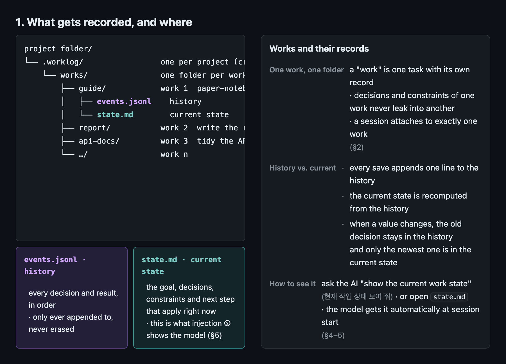
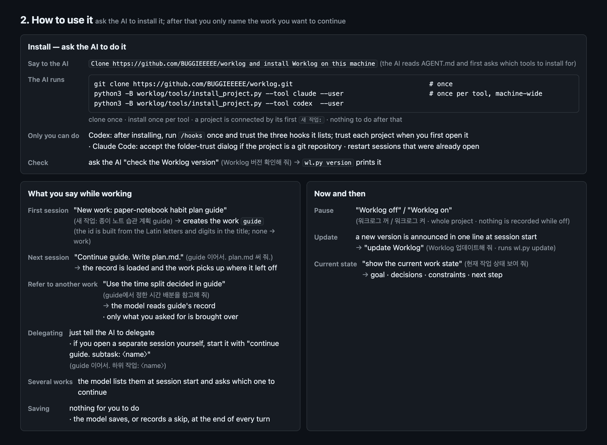
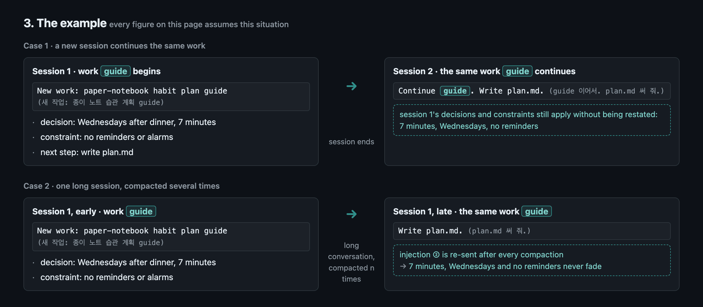
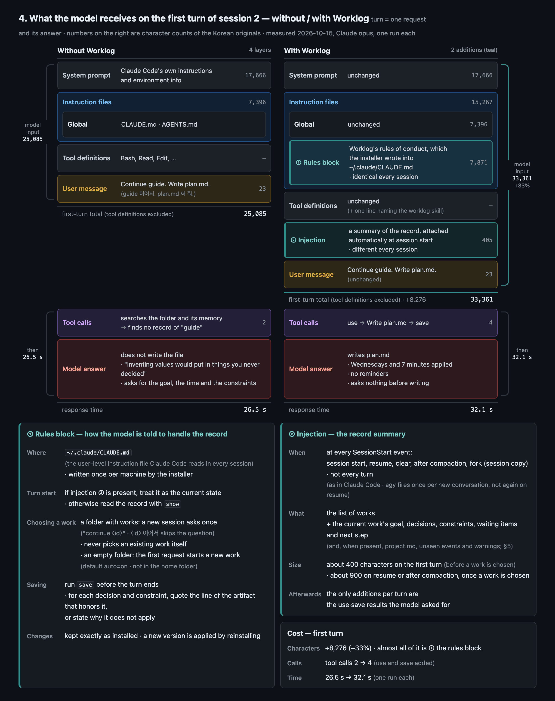
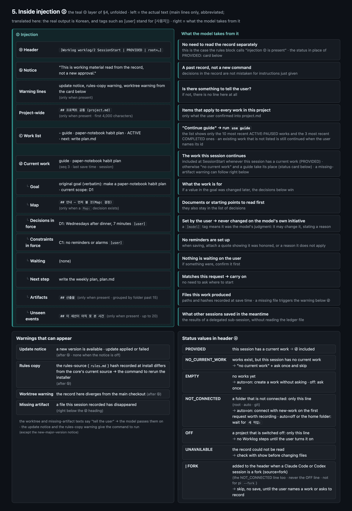
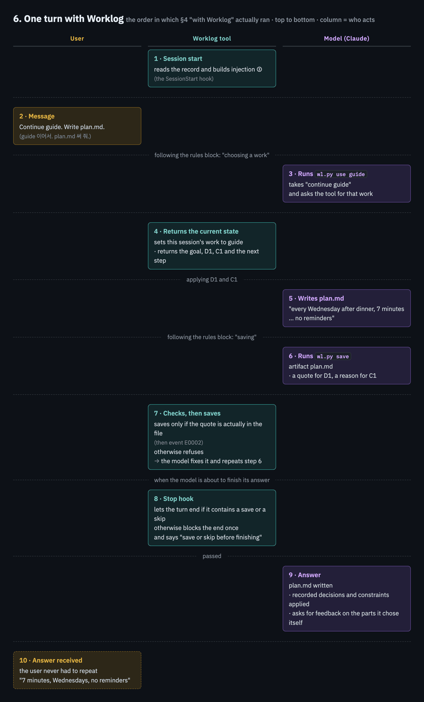
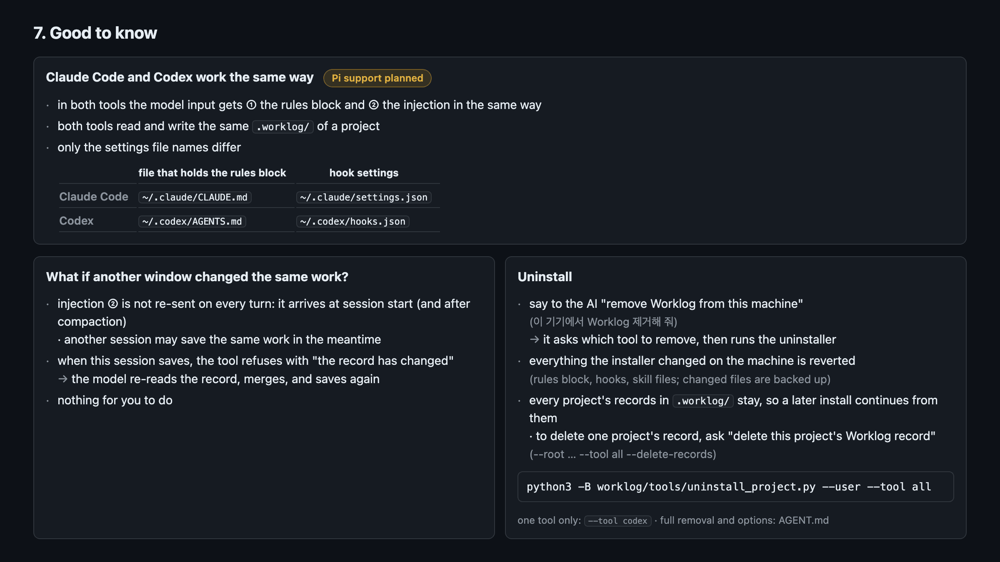
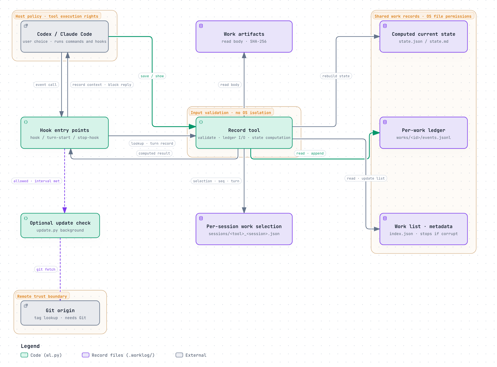
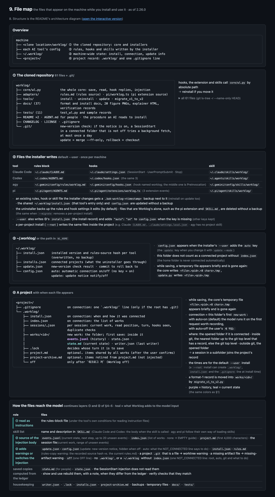

# worklog

[한국어](README.ko.md) · AI agent? Read [AGENT.md](AGENT.md)

**Keeps Claude Code, Codex, agy (Antigravity CLI) and pi from forgetting what was decided, even after a compaction or a new session.** Ask the AI to install it; after that you only name the work you want to continue.



Added to the machine (once per tool): one rules block in the tool's user-level instruction file (`~/.claude/CLAUDE.md`, `~/.codex/AGENTS.md` or `~/.pi/agent/AGENTS.md`; your own content is kept; agy gets its own rule file `~/.gemini/config/rules/worklog.md`), 3 hooks (`~/.claude/settings.json`, `~/.codex/hooks.json` or the named hook `worklog` in `~/.gemini/config/hooks.json`; pi: the extension `~/.pi/agent/extensions/worklog.ts`), `skills/worklog/` (Claude: `~/.claude/`, Codex: `~/.agents/`, agy: `~/.gemini/config/`, pi: `~/.pi/agent/`). Added to a project: `.worklog/` at the first request worth recording (2.25.0), and in a git project the `.worklog/` line in `.gitignore` (the record is per-machine state and quotes you, so it stays out of git). Opening a session writes nothing.

**Starting with a plain request (2.25.0).** You no longer have to type `새 작업:` first. In a folder with no record yet, the first request you want a result from (a change, an analysis, a question; not a greeting) starts a new work, titled after the request unless you give a title, and the agent says so in one line at the end of its answer. In a folder that already has works, a new session asks once which work to record into, or a new one, before doing the request; start with `<id> 이어서` to skip that question. The agent never picks an existing work for you. The record goes to the git top level, or to the nearest folder inside it that already has a record; outside git, to the folder you opened. Wrong work: say so (`그거 <id> 작업이야`) and the agent runs `reassign`. The saved events stay where they are; the decisions and constraints they added leave the wrong work, and those decisions, constraints and artifacts are recorded again in the right one (the goal, waiting items and next action do not move). Wrong title: `rename`. To keep the old behaviour (nothing until `새 작업: <title>`), set `"auto": "off"` in `~/.worklog/config.json`; `워크로그 꺼` turns one project off as before.

The phrases you type are Korean, and so are the model-facing rules and messages. They are short; copy them from here.



Phrases to copy: `새 작업: <title>` (new work, optional since 2.25.0) · `<id> 이어서` (continue) · `<id>에서 정한 <thing>을 참고해 줘` (use what was decided in another work) · `워크로그 꺼` / `워크로그 켜` (off / on) · `Worklog 업데이트해 줘` (update) · `현재 작업 상태 보여 줘` (show the current work state) · `Worklog 제거해 줘` (remove)

Install — the commands the AI runs (you can run them yourself; clone once, install once per tool for the whole machine; to install for one project only, use `--root /path/to/project` instead of `--user`):

```sh
git clone https://github.com/BUGGIEEEEE/worklog.git
python3 -B worklog/tools/install_project.py --tool claude --user
python3 -B worklog/tools/install_project.py --tool codex  --user
python3 -B worklog/tools/install_project.py --tool agy    --user   # Antigravity CLI (2.24.0)
python3 -B worklog/tools/install_project.py --tool pi     --user   # pi (2.24.0)
```

Check the install — it prints the core version (see `CHANGELOG.md`):

```sh
python3 -B worklog/core/wl.py version
```

Remove — the agent asks which tool to remove. Every project's records in `.worklog/` stay (to delete one project's record: `--root /path/to/project --tool all --delete-records`). Example (`--tool codex` removes one tool only):

```sh
python3 -B worklog/tools/uninstall_project.py --user --tool all
```

- Requirements: Python 3.9+ (tested on 3.9.6 and 3.14), macOS or Linux. Keep the clone where it is (the hooks call it by path). The installer changes only the tool's own settings files and backs up every file it changes; connected projects are listed in `~/.worklog/installs.json` (used by the uninstaller).
- Update: a git clone checks the origin tags in the background once a day (session start, never waits) and the next session shows one line when a newer version exists. `wl.py update` fast-forwards to the newest tag of the same major version and reinstalls the machine-level rules block and skill; `update rollback` undoes it, `update --mode off` silences the notice.
- Delegating: just tell the agent to delegate. If you open a separate session yourself, start its first prompt with `<id> 이어서. 하위 작업: <name>` ("continue <id>. subtask: <name>"); for an independent work that finishes on its own, use `새 작업: <title>` and list which decisions and constraints it inherits. The agent keeps the record as the rules say.
- Full removal (every project plus `~/.worklog`) and all uninstall options: [AGENT.md](AGENT.md).











<picture>
  <source media="(prefers-color-scheme: dark)" srcset="docs/img/en-08-architecture-dark.png">
  
</picture>

8. Structure — [open the interactive version](https://buggieeeee.github.io/worklog/archify/worklog-architecture.en.html): click a box to see its connections and the source lines (GitHub links) it is based on. Sources and the Korean version: [docs/archify/](docs/archify/)



Details: [docs/ADAPTERS.md](docs/ADAPTERS.md) · [docs/FORMAT.md](docs/FORMAT.md) · [docs/VERIFICATION.md](docs/VERIFICATION.md) · MIT ([LICENSE](LICENSE))
